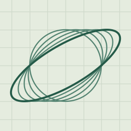
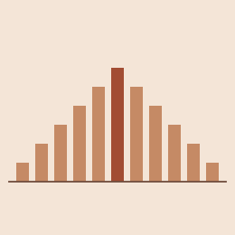

::::: {.home-shell role="main"}
:::: {.home-hero}
::: {.hero-copy}
[City Tech · CUNY]{.eyebrow}

<h1 class="hero-title">Mathematical <em>field notes</em></h1>

::: {.hero-intro}
Explore linear algebra and statistics through interactive figures, worked examples, and probability experiments you can run in R.
:::

[Browse courses ↓](#courses){.primary-link}
:::



::::

<section id="courses" class="course-section" aria-labelledby="course-heading">
<h2 id="course-heading">Courses</h2>

:::: {.course-grid}
::: {.course-tile}

::: {.tile-copy}
[MAT 2580]{.course-code}

### [Introduction to Linear Algebra](linear-algebra.qmd)

Follow a circle through a shear and see how a matrix can change shape while preserving area.
:::
:::

::: {.course-tile}

::: {.tile-copy}
[MAT 1372]{.course-code}

### [Statistics with Probability](probability.qmd)

Roll a pair of dice, count the ways to make a sum, and test your prediction with R.
:::
:::
::::
</section>
:::::
