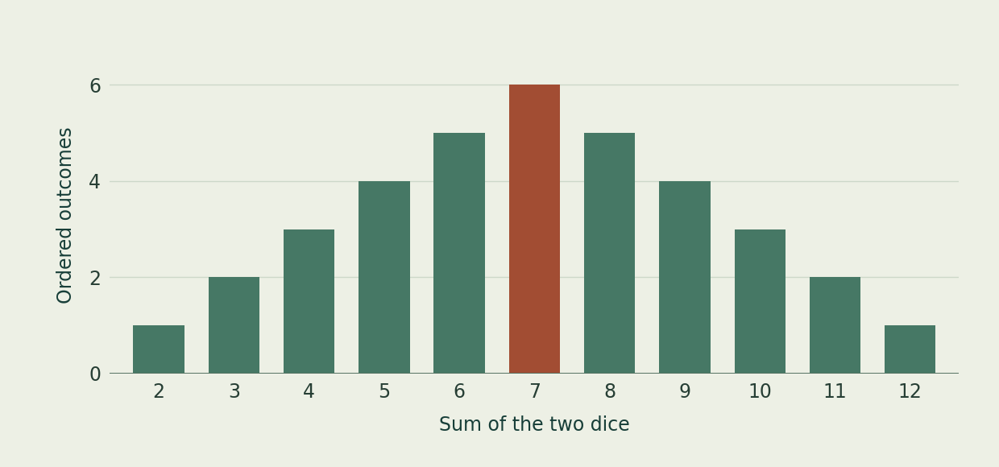

::::: {.reading-shell role="main"}
[← Courses](index.qmd#courses){.back-link}

::: {.page-intro}
[MAT 1372 · Statistics with Probability]{.eyebrow}

# Why is seven the most likely sum?

Roll two independent, fair six-sided dice. Each face is equally likely on either die. Why, then, do some totals appear much more often than others?
:::

<figure class="dice-figure">

<figcaption>Number of ordered outcomes for each sum of two dice.</figcaption>
</figure>

:::: {.lesson-prose}
## Count pairs before you count sums

Picture a red die and a blue die. A red 2 and a blue 5 is a different outcome from a red 5 and a blue 2. That gives $6\times6=36$ equally likely ordered pairs.

The pairs $(1,6)$, $(2,5)$, $(3,4)$, $(4,3)$, $(5,2)$, and $(6,1)$ all sum to seven. Only $(1,1)$ sums to two. So $P(\text{sum}=7)=6/36=1/6$, and $P(\text{sum}=2)=1/36$.

## Try the experiment in R

Run this code in RStudio or Positron. What fraction of the rolls add to seven? Compare it with $1/6$.

```r
set.seed(1372)
n <- 10000
red <- sample.int(6, n, replace = TRUE)
blue <- sample.int(6, n, replace = TRUE)
mean(red + blue == 7)
```

Each comparison produces `TRUE` or `FALSE`. R counts those as 1 and 0 when it takes their mean, so the result is the fraction of successes. Change the seed and see how the estimate varies.

::: {.practice}
### Try it

Which total is more likely, six or eight? Find all the pairs for one total, then look for a shortcut for the other.

<details><summary>Show the reasoning</summary>

Five pairs make six, starting with $(1,5)$ and ending with $(5,1)$. Replace each face $d$ by $7-d$. This pairs every roll totaling six with exactly one roll totaling eight, so both probabilities are $5/36$.

</details>
:::

[City Tech course information](https://openlab.citytech.cuny.edu/mathematics-department/course-materials/mat-courses/mat-1372/){.source-link}
::::
:::::
